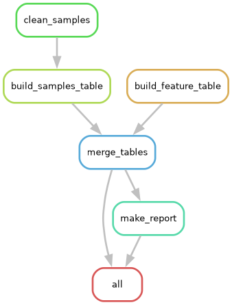

# Lab 5: Scalable Analysis Workflow

A Snakemake workflow that chains my Lab 3 and Lab 4 work into one reproducible pipeline: clean the messy samples file, query the TGCA lung adenocarcinoma db, stack the two tables into one combined analytic table, and produce a summary figure and text summary.



| Rule | Inputs | Outputs | Script |
|---|---|---|---|
| `clean_samples` | `data/raw/lab3-messy-data/messy_samples.csv` | `results/samples_clean.csv` | `scripts/clean_samples_regex.py` (Lab 3) |
| `build_samples_table` | `results/samples_clean.csv` | `results/samples_table.csv` | `scripts/build_analytic_table.py` (Lab 3) |
| `build_feature_table` | `data/raw/lab4-cbioportal-luad/cohort.db`, `sql/query_3.sql`, `sql/query_1.sql` | `results/feature_table.tsv` | `scripts/build_feature_table.py` (Lab 4) |
| `merge_tables` | `results/samples_table.csv`, `results/feature_table.tsv` | `results/combined_table.csv` | `scripts/merge_tables.py` |
| `make_report` | `results/combined_table.csv` | `results/summary_figure.png`, `results/summary.md` | `scripts/make_report.py` |

`rule_all` requests the three final files, so Snakemake  builds everything they depend on. Every file a step reads is declared as an input in the `Snakefile`, including the SQL files. The Lab 3 and Lab 4 scripts keep their originial logic. I only changed them to take their input and output paths as CLI arguments so Snakemake can see them.

## Repository contents
```text
lab-5-hds/
├── README.md
├── AI_USAGE.md
├── Snakefile
├── environment.yml
├── .gitignore
├── scripts/       # the 5 Python scripts above
├── sql/           # query_1.sql, query_3.sql (from Lab 4)
├── results/       # combined table, summary figure and text summary, and intermediate tables
├── evidence/      # console logs of the clean run and partial re-run, and workflow graphs
└── data/          # NOT in the repo; created by the download step below
```

## Setup

Created and tested on Ubuntu (WSL2) with conda/mamba and VSCODE.

```bash
git clone https://github.com/nlinares-GWU2026/lab-5-hds.git
cd lab-5-hds
mamba env create -f environment.yml      # or: conda env create -f environment.yml
conda activate lab-5-hds
```

The input data is not stored in this repo. It comes from the course repo (`gwcbi/applied-computing-HDS`). You can download it by:

```bash
mkdir -p data/raw/lab3-messy-data data/raw/lab4-cbioportal-luad
curl -L -o data/raw/lab3-messy-data/messy_samples.csv https://raw.githubusercontent.com/gwcbi/applied-computing-HDS/main/data/raw/lab3-messy-data/messy_samples.csv
curl -L -o data/raw/lab4-cbioportal-luad/cohort.db https://raw.githubusercontent.com/gwcbi/applied-computing-HDS/main/data/raw/lab4-cbioportal-luad/cohort.db
echo "7cddee83b693c6c7a4effd6c7276bf031ed2eeb8592ea3f37d87792f41d6e33c  data/raw/lab3-messy-data/messy_samples.csv" | sha256sum -c -
echo "6da3f91401918dda543aced9fa6f411dcecf204552cebfc6e54ab7d8f387e8e7  data/raw/lab4-cbioportal-luad/cohort.db" | sha256sum -c -
```

Both checksum lines should print `OK`.

## Usage

Run all commands from the repo root with the environment active.

### Full clean run
`results/` is committed so the outputs can be inspected without running everything. This command deletes it and revuilts everything from scratch with the raw data: 

```bash
snakemake --delete-all-output
snakemake --cores 2
```

Expected: `total 6` jobs run, and the output includes `Wrote 60 rows to results/samples_clean.csv`,
`Wrote 60 rows to results/samples_table.csv`, `Wrote results/feature_table.tsv: 566 rows x 11 columns`,
and `Wrote results/combined_table.csv: 626 rows x 13 columns`.  A second `snakemake -n` then says
`Nothing to be done`. Logged in `evidence/01_clean_run.log` and `evidence/02_up_to_date_check.log`.

### Partial re-run

This changes one upstream input (a comment line added to `sql/query_1.sql`. The results do not change) and shows that only the steps that depend on it re-run:

```bash
sed -i '1i -- Comment added to demonstrate a partial re-run' sql/query_1.sql
snakemake -n          # dry run: lists the jobs that would run and why
snakemake --cores 2
```

Expected: `total 4` jobs (`build_feature_table`, `merge_tables`, `make_report`, `all`).
`clean_samples` and `build_samples_table` do not re-run because nothing they depend on changed.
Logged in `evidence/03_partial_rerun_dryrun.log` and `evidence/04_partial_rerun.log`.
(`sed -i` as written is for Linux/WSL.) To undo the edit and bring `results/` back in line:

```bash
git checkout sql/query_1.sql
snakemake --cores 2
```

### Other commands used:

```bash
snakemake -n                                   # dry run
snakemake --dag | dot -Tpng > evidence/dag.png # draw the job graph
```

## Outputs

- `results/combined_table.csv`: the final combined analytic table (626 rows x 13 columns)
- `results/summary_figure.png` and `results/summary.md`: the summary report (age and sex by cohort, plus cohort-level summaries)
- `results/samples_clean.csv`, `results/samples_table.csv`, `results/feature_table.tsv`: intermediate tables

## How the two tables were combined

The Lab 3 table (60 clinical samples) and the Lab 4 table (566 TCGA lung adenocarcinoma patients) are different groups of people with no shared ID, so they cannot be joined row-to-row. `scripts/merge_tables.py` instead reneames the columns the two tables have in common (`sex`, age, site) to one scheme and stacks the rows. A `cohort` column  (`clinic_samples` or `luad_tcga`) says where each row came from. Columns that exist in only one table (glucose, stage, tumor mutation burden, and gene counts) are `NA` for the other. Sex is coded `male`/`female`/`unknown`. A missing sex in the Lab 4 data becomes `unknown` which matches Lab 3's `U`.

## Comments

- **Merge approach:** the lab says "merge the two into one combined analytic table", but the two datasets share no identifier and no people. I chose to stack them on their shred columns instead of joining them, and the reason is described above. IF a different merge was intended, `scripts/merge_tables.py` is the only script and Snakefile rule that would have to change. 
- **Age is not the same quantity in both cohorts:** `age_years` is the age as of 2026-09-30 for the clinical samples and age at diagnosis for the lung adenocarcinoma patients. The summary notes this. 

## AI Usage
See [AI_USAGE.md](AI_USAGE.md).